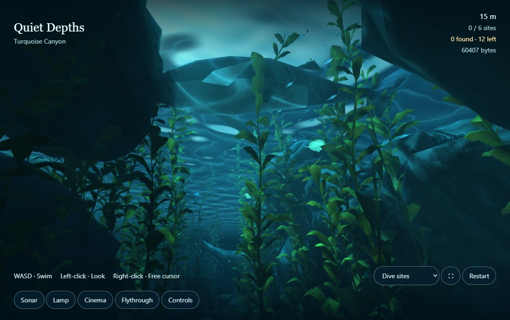

# Akvarium · Quiet Depths

**The first playable prototype was 18,011 bytes (17.6 KiB).** Akvarium is still a single HTML file: a procedural 3D ocean you can swim through, with no installation, build step, or external assets.

## Two ways to dive

### Akvarium · Full edition

**62,865 bytes (61.4 KiB)** · [Play in browser](https://triple6xseven.github.io/Akvarium/)

### Akvarium Mini

- **Fullscreen, 15,860 bytes (15.5 KiB)** · [Watch in browser](https://triple6xseven.github.io/Akvarium/Akvarium-1K.html) · [HTML file](Akvarium-1K.html)
- **Portrait 9:16, 15,893 bytes (15.5 KiB)** · [Watch in browser](https://triple6xseven.github.io/Akvarium/Akvarium-9x16.html) · [HTML file](Akvarium-9x16.html)

A looping flythrough through the kelp canyon, with a whale passing overhead. Click **Explore** or press **V** to fly freely. Move with **WASD / arrows**, rise or dive with **Space / C**, and drag to look around. Touchscreens get on-screen movement controls. Press **V** again to return to the flythrough. Each layout runs from one self-contained HTML file. Press **F** or click **Fullscreen** for browser fullscreen. The [Mini branch](https://github.com/triple6xseven/Akvarium/tree/mini) opens the fullscreen layout by default.

## Start a dive

- **Online:** click **Play in browser**. The ocean opens immediately. Move with **WASD**, look with the mouse, or press **V** to watch the flythrough.
- **Offline:** download **Akvarium.html** and double-click it. If it opens in an editor, right-click the file and choose **Open with**, then pick your browser.
- **Touchscreens:** drag over the water to look and hold the on-screen swim buttons to move.
- Use a browser with WebGL and hardware acceleration enabled. If you see a blank scene or a WebGL error, try a current desktop Edge, Chrome, or Firefox with hardware acceleration on.

## What’s underwater

- **Cinematic cameras:** press **V** for a guided tour that opens with a whale crossing overhead. The manual Cinema camera starts enabled, with smoother turns, a narrower frame, and a subtle vignette. Press **M / Ь** to toggle it.
- **Swim physics:** slow acceleration, coasting, gentle currents, separate rise and dive controls, and collision with terrain and rocks.
- **Procedural shaders:** animated surface reflections and caustics, soft shadow mapping, shafts of sunlight, and depth-dependent haze.
- **Six dive sites:** kelp forest, stone whale fluke, shipwreck, jellyfish grotto, hydrothermal vents, and a sunken Roman forum with a mosaic floor.
- **Wildlife and hidden coins:** watch fish, rays, turtles, and a whale. Swim close to collect 12 coins. The HUD shows how many are found and left, and the browser remembers your progress where local storage is available.
- **Dive gear:** a forward lamp, visible sonar pulses, quick jumps between dive sites, and a clean view for recording.

## Controls

The in-game **Controls** button opens the full list.

- **WASD / arrow keys** — swim forward, backward, and sideways.
- **Captured mouse / touch drag** — look around.
- **Left-click the water** — capture the mouse for continuous looking.
- **Right-click / Esc** — free the cursor to use the HUD. Moving the free cursor leaves the view direction fixed.
- **Space / C** — rise / dive.
- **Shift** — swim faster while held.
- **F** — toggle fullscreen.
- **H** — toggle the HUD.
- **L** — toggle the dive lamp.
- **Q** — send a sonar pulse.
- **R** — reset the coin hunt at the current locations.
- **T** — shuffle all 12 coins across six dive sites and restart the hunt.
- **M / Ь** — toggle the manual Cinema camera (on by default).
- **V** — start or stop Flythrough.
- **Esc** — also exits Flythrough. The browser handles exiting fullscreen with Esc.
