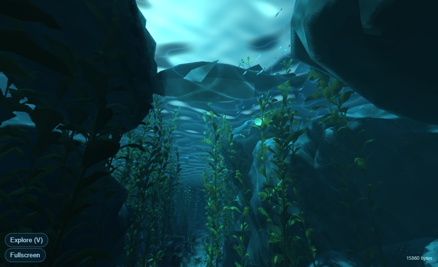
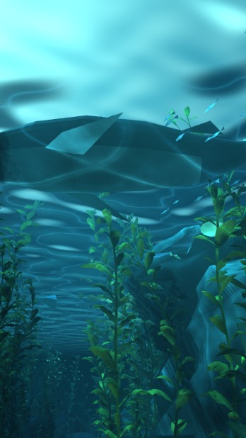

# Akvarium Mini

- **Fullscreen, 15,860 bytes (15.5 KiB)** · [Watch in browser](https://triple6xseven.github.io/Akvarium/Akvarium-1K.html) · [Default HTML](index.html)
- **Portrait 9:16, 15,893 bytes (15.5 KiB)** · [Watch in browser](https://triple6xseven.github.io/Akvarium/Akvarium-9x16.html) · [Portrait HTML](Akvarium-9x16.html)

A looping underwater flythrough through a kelp canyon. A whale passes overhead as the camera rises off the reef. Each layout runs from a single HTML file with no external assets.

 

Open either link to watch. Press **F** or click **Fullscreen** for browser fullscreen. For offline playback, save the HTML file and open it in a current browser with WebGL enabled. [See the full interactive edition](https://github.com/triple6xseven/Akvarium/tree/main).
